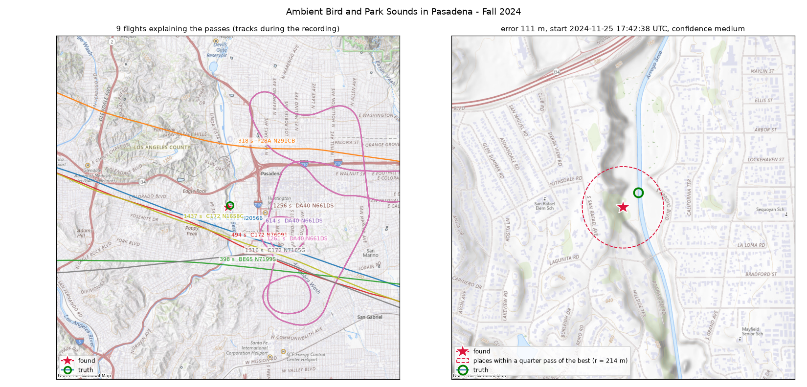
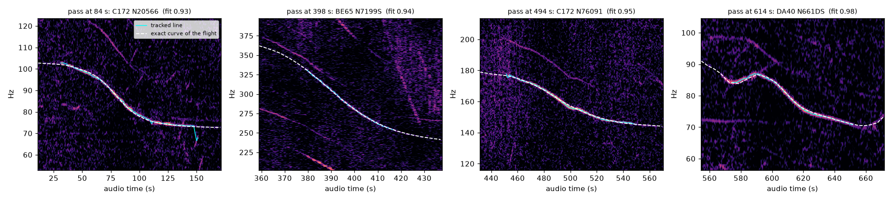
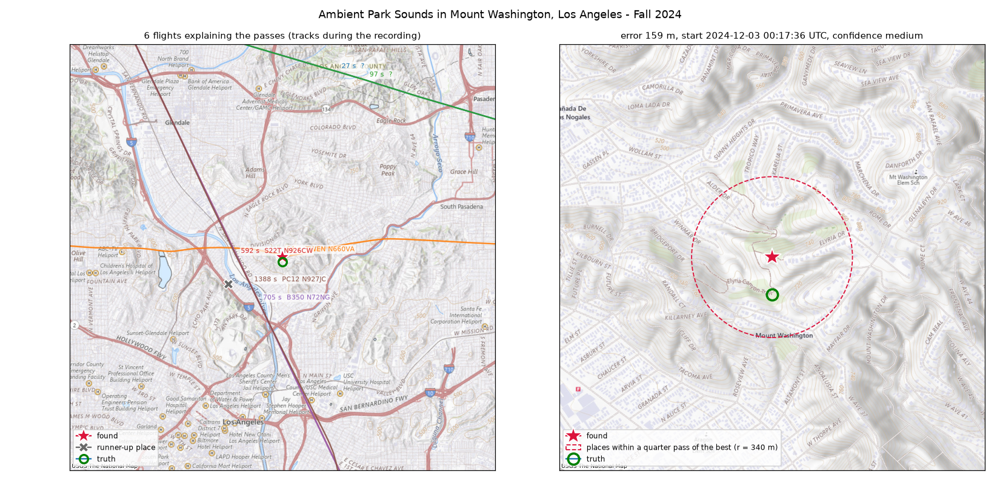
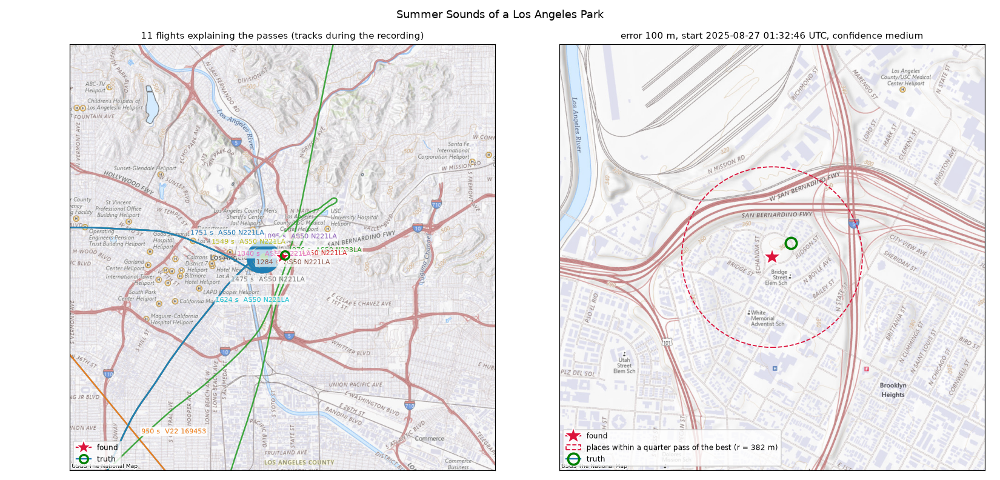
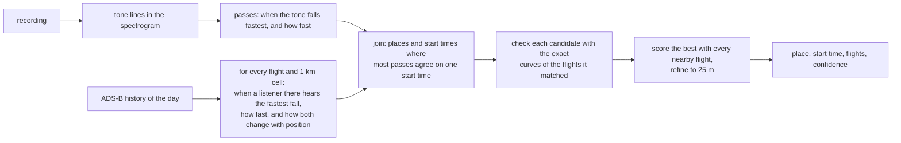

# doppler-geo

English | [中文](README.zh-CN.md)

Find where and when an audio recording was made, from the hum of aircraft flying over it.

Propeller aircraft and helicopters hum at steady frequencies. As one passes, the hum a microphone picks up
slides down in pitch (the Doppler effect), and the exact shape of that slide depends on where the microphone
was relative to the flight path. Public ADS-B history records where every transponder-equipped aircraft was,
second by second. doppler-geo finds the passes in a recording and searches for the place and start time at
which real flights would have produced exactly those tones. The tones are often quiet enough that nobody
listening would notice them, but they are clear in a spectrogram.

```python
import dopgeo

result = dopgeo.locate("pasadena.webm", date="2024-11-25", tz="America/Los_Angeles",
                       center=(34.30, -117.95), radius_km=80)

print(result.lat, result.lon)        # 34.13641 -118.16873   (111 m from where it was recorded)
print(result.recording_start)        # 2024-11-25 17:42:38+00:00   (recorded at 09:42 local time)
print(result.confidence)             # medium
```

That recording is a 25-minute park ambience video on YouTube. The search was told only the date and a
160 km box over the Los Angeles basin; it worked out the place and the time of day from the light aircraft
heard in the background.



The left panel shows the flight tracks, during the recording, of the nine aircraft that explain the passes:
Cessna 172s on a common route, a Piper, a Beech 65, and a Diamond DA40 flying training circles. The right
panel is a close-up: the red star is the place found, the green circle the coordinates given in the video's
description, 111 m apart. The dashed circle contains the places that score within a quarter of a pass of the
best one.

The idea comes from the colsto video
[*I discovered a sound that leaks your exact location*](https://www.youtube.com/watch?v=UytYrhYLOKI),
which demonstrated it on one recording and released no code. This project is an independent, open
implementation with its own search method, described below.

## Contents

- [Real recordings from YouTube](#real-recordings-from-youtube)
- [How it works](#how-it-works)
- [Installation](#installation)
- [Usage](#usage): Python, command line, HTTP
- [Synthetic benchmark](#synthetic-benchmark)
- [Data sources](#data-sources)
- [Limitations](#limitations)
- [Responsible use](#responsible-use)

## Real recordings from YouTube

The channel [The Ambient Archive](https://www.youtube.com/@TheAmbientArchive) publishes field recordings
of parks in Los Angeles and gives the exact coordinates and local start time in each description. Nothing
in these recordings is about aircraft: they are birds, traffic, children and wind, with light aircraft
somewhere in the background. Each recording longer than 20 minutes with at least a few clear passes was
searched the same way: a 160 km box over the Los Angeles basin centred about 30 km from the truth, the
local date, and nothing else. [`examples/youtube_cases.py`](examples/youtube_cases.py) downloads the audio
and reproduces the table.

| recording | passes used | place error | start time found | confidence | time |
|---|---|---|---|---|---|
| [Pasadena, 25 Nov 2024 09:42](https://www.youtube.com/watch?v=JqRT1PCNCqg) | 12 (9 explained) | 111 m | 17:42:38 UTC (stated 17:42) | medium | 98 s |
| [Mount Washington, 2 Dec 2024 16:17](https://www.youtube.com/watch?v=3rRfrnaruFo) | 6 (6 explained) | 159 m | 00:17:36 UTC (stated 00:17) | medium | 39 s |
| [Downtown park, 26 Aug 2025 18:33](https://www.youtube.com/watch?v=5PAHqKy-vRo) | 11 (11 explained) | 100 m | 01:32:46 UTC (stated 01:33) | medium | 56 s |
| [Pasadena, 25 Nov 2024 09:05](https://www.youtube.com/watch?v=UVBbkumxkek) | 7 (5 explained) | wrong (35 km) | | low | 29 s |
| [Elysian Park, 24 Nov 2024 17:25](https://www.youtube.com/watch?v=8YW6H7uB_sg) | 11 (7 explained) | wrong (26 km) | | low | 44 s |

Three of the five were found to within about 150 m, with the start time inside the minute given in the
description. The two misses are both marked `low`: the first has only a few clear passes, and in the second
each pass matches a flight well on its own but not with one common start time, which is what an edited
(cut and joined) recording would look like.



This is what the match looks like for the Pasadena recording. Each panel is a stretch of the spectrogram
around one pass; the cyan line is the tone tracked in the audio, and the dashed white line is the Doppler
curve that the named aircraft, at its ADS-B positions, would have produced at the place and time found. The
DA40 on the right was turning: its tone falls, rises and falls again, and the computed curve follows it.

<table><tr>
<td></td>
<td></td>
</tr></table>

The other two recordings that were found, in the same layout as the first map: Mount Washington (left) and
a park near downtown Los Angeles (right).

### Which recordings work

The method needs aircraft whose tone is steady and low: propeller aircraft and helicopters. It worked here
because Los Angeles has a lot of light-aircraft traffic below 1,500 m and dense ADS-B reception. Recordings
that did not work, and why:

- **Airport plane-spotting livestreams** (JFK, LAX, SFO): airliners give broadband roar rather than steady
  tones below 1 kHz, and commentary and air-traffic-control audio cover the spectrum.
- **A seaplane fly-in in rural Maine**: the floatplanes heard taking off in front of the camera flew below
  the lowest altitude the local ADS-B receivers pick up, so they are not in the data.
- **The recording from the colsto video**: after repairing broken tone lines, its two main passes are tracked
  in full, but at the coordinates read out in the video no flight in the adsb.lol data explains both of them
  with one start time, in 2025 or 2026. Either the passes used in the video are others than the two found
  here, or the year or the coordinates differ.

Good candidates are therefore unedited ambient recordings with no talking or music, made in or near a city,
with the place and date known for checking.

## How it works



**1. Passes in the audio.** The recording is decoded to 2 kHz and turned into a spectrogram. Continuous tone
lines are tracked, broken pieces of one line are joined again, and stretches whose frequency falls are kept
as passes. Tones whose frequencies keep a constant ratio while they fall come from one aircraft (an engine
and a propeller, say) and count once. For each pass the tool measures when the tone falls fastest and how fast, in
log frequency per second, which removes the aircraft's unknown rest frequency.

**2. What each flight would sound like.** For a listener at distance `R` from an aircraft with velocity `v`
and acceleration `a`, the tone falls at the rate

    D = [ (|v|² − ṙ²) / R + a·u ] · c / (c + ṙ)²

(`ṙ` is the rate of change of distance, `u` the direction from listener to aircraft, `c` the speed of
sound). For a straight, steady pass the fastest fall is heard at the closest approach. For aircraft that are
turning, climbing or speeding up the acceleration term moves it, sometimes by more than a minute. Because `v`
and `a` come from each flight's own ADS-B data, the formula covers both.

**3. Candidates.** For every flight and every 1 km cell within 15 km of its track, the tool computes when a
listener in that cell would hear the fastest fall, how fast, and how both change with position inside the
cell. Moving 500 m along a flight path delays the pass by several seconds, so place and time are linked;
keeping that link lets the search check 25 points 200 m apart in each cell for the cost of one. This step
depends only on the ADS-B data. The recording comes in at the join: each pass picks the flights whose fall
rate fits it, and the search keeps places and start times where most passes agree on a single start time.

**4. Checking.** In busy airspace there are millions of such coincidences. Each one already names a flight
for each pass, so it is checked cheaply with the exact Doppler curves of those flights only. The best few
thousand are then scored with every flight within 12 km tried against every pass, emission times solved and
the ground height of the place taken into account, and the best place is refined to a 25 m grid.

[docs/method.md](docs/method.md) gives the details, including how the join avoids checking every place and
time.

## Installation

Python 3.11 or newer, and [ffmpeg](https://ffmpeg.org/) on the path (used to read any audio or video format).

```sh
pip install git+https://github.com/cyang2020/doppler-geo
# optional extras: [plot] for map backgrounds, [server] for the HTTP API
pip install "doppler-geo[plot,server] @ git+https://github.com/cyang2020/doppler-geo"
```

The first search for a day downloads that day's ADS-B history from adsb.lol: about 3.5 GB, kept as about
1 GB per UTC day in `~/.cache/dopgeo/adsb` (set `DOPGEO_CACHE` to use another directory). A search on a local
day needs two UTC days. `dopgeo fetch 2024-11-25` fetches a day ahead of time.

## Usage

### Python

```python
import dopgeo
from dopgeo.plot import plot_result

# what is in the recording
for p in dopgeo.detect_passes("recording.wav"):
    print(p.time_s, p.rest_frequency_hz, p.clear, p.fastest_fall_s)

# where and when
result = dopgeo.locate(
    "recording.wav",
    date="2024-11-25", tz="America/Los_Angeles",  # or start="2024-11-25T17:40Z", start_tolerance_s=1800
    center=(34.1, -118.2), radius_km=80,          # or area=dopgeo.Area(lat_min, lat_max, lon_min, lon_max)
    exclude_jets=False,                           # True to ignore known jet types
    output_dir="out",                             # optional: result.json, map.html, curves.png
)
for m in result.matches:                           # which flight explains each pass
    print(m.audio_time_s, m.aircraft_type, m.registration, m.fit)
plot_result(result, "result.png")
print(result.to_json())
```

`locate` returns a `Result` with the place, the UTC start time, a confidence label, the flight that explains
each pass, the runner-up place at least 2 km away and the time taken by each step. `dopgeo.synthesize` makes
a synthetic recording from real traffic for testing.

### Command line

```sh
dopgeo passes recording.wav                       # list the passes
dopgeo locate recording.wav --date 2024-11-25 --tz America/Los_Angeles \
       --center 34.1 -118.2 --radius-km 80 --out out/
dopgeo synth --lat 34.137 --lon -118.168 --start 2024-11-25T17:42:00 \
       --duration 1500 --out test.wav            # synthetic recording from real traffic
```

### HTTP

```sh
pip install "doppler-geo[server] @ git+https://github.com/cyang2020/doppler-geo"
dopgeo serve --port 8000
curl -X POST http://127.0.0.1:8000/locate -F file=@recording.wav \
     -F date=2024-11-25 -F tz=America/Los_Angeles -F center_lat=34.1 -F center_lon=-118.2 -F radius_km=80
```

`POST /locate` returns the same fields as `Result.to_dict()`, `POST /passes` lists the passes, and the
interactive documentation is at `http://127.0.0.1:8000/docs`. A search holds its request for its whole
duration, so the server is meant for local or internal use.

### Confidence

`high`: at least four passes explained, a lead of at least 1.5 passes over the best place 2 km or more away,
and a total score of at least 60 % of the passes. `medium`: three passes, a lead of 0.75, 40 %. Otherwise
`low`. In the tests here no `high` answer was wrong; `low` answers were sometimes right and sometimes wrong,
and mean that the recording does not rule out other places.

## Synthetic benchmark

[`benchmarks/`](benchmarks/) holds 20 synthetic recordings. Each is built from the real ADS-B traffic that
passed within 6 km of a real place at a real time: every flight becomes a Doppler-shifted tone with a random
rest frequency and harmonics, in noise. Each is searched like the YouTube recordings: a 160 km box centred
25 to 45 km from the truth, the local date, nothing else. `python benchmarks/run.py` regenerates and
reruns them.

All 19 recordings with at least two passes were found, 6 to 213 m from the truth (median 31 m), with the start
time within 2.1 s; the one recording with a single pass was refused. The times are on an 8-core laptop that
was running other work at the same time (load average 13 to 20); the median was 37 s. These recordings are
easier than real ones: every aircraft in them, airliners included, emits a clean tone, and nothing else does.

| case | aircraft heard | error | start error | confidence | passes used / explained | time |
|---|---|---|---|---|---|---|
| long-island | 10 | 28 m | +0.1 s | high | 12 / 11 | 144 s |
| sf-bay | 16 | 31 m | +0.2 s | high | 12 / 10 | 39 s |
| denver | 18 | 159 m | +0.1 s | high | 12 / 11 | 36 s |
| irvine-a | 2 | 9 m | +0.2 s | medium | 5 / 3 | 46 s |
| orlando-a | 24 | 6 m | +0.1 s | high | 12 / 12 | 24 s |
| seattle-a | 18 | 59 m | -0.2 s | high | 12 / 10 | 18 s |
| chicago-a | 12 | 35 m | -0.2 s | high | 12 / 12 | 37 s |
| dallas-a | 17 | 36 m | +0.0 s | high | 12 / 11 | 59 s |
| boston-a | 3 | 59 m | +0.3 s | medium | 4 / 4 | 12 s |
| austin-a | 27 | 11 m | +0.3 s | high | 12 / 12 | 11 s |
| portland-a | 4 | 24 m | +0.0 s | high | 6 / 5 | 11 s |
| irvine-b | 15 | 8 m | -0.1 s | high | 12 / 6 | 102 s |
| orlando-b | 14 | 25 m | +0.4 s | high | 9 / 6 | 45 s |
| seattle-b | 44 | 201 m | -2.1 s | medium | 12 / 8 | 31 s |
| chicago-b | 6 | 28 m | +0.1 s | high | 6 / 6 | 27 s |
| dallas-b | 64 | 213 m | +1.3 s | high | 12 / 10 | 45 s |
| boston-b | 10 | 38 m | -0.4 s | high | 12 / 10 | 64 s |
| austin-b | 8 | 16 m | +0.2 s | high | 10 / 9 | 15 s |
| portland-b | 1 | refused (one pass) | | | | 1 s |
| oyster-bay | 12 | 149 m | +0.6 s | high | 11 / 6 | 68 s |

## Data sources

| data | source | licence | used for |
|---|---|---|---|
| ADS-B history | [adsb.lol globe_history](https://github.com/adsblol) daily releases | ODbL 1.0 | where every aircraft was |
| terrain height | [Terrain Tiles on AWS](https://registry.opendata.aws/terrain-tiles/) | see the dataset's attribution | the listener's height |
| aircraft types | [tar1090-db](https://github.com/wiedehopf/tar1090-db) | see the project | telling jets from other aircraft |
| geoid (EGM96) | PROJ data | | converting ADS-B heights |
| map background | [USGS The National Map](https://www.usgs.gov/programs/national-geospatial-program/national-map) | public domain | figures |

None of these are redistributed here; they are downloaded on first use. The YouTube recordings are not
redistributed either; the example script downloads them.

## Limitations

- Only aircraft that broadcast ADS-B and were received by the adsb.lol network can explain a pass. Light
  aircraft flying low away from cities are often missing.
- Airliners rarely give usable tones; the passes come mostly from propeller aircraft and helicopters.
- With only two or three clear passes, several places often fit equally well; the answer is then `low`.
- Search time grows with the air traffic in the area. On an 8-core laptop (that was also running other
  work), a 160 km box over Los Angeles took 30 seconds to 2 minutes, a 50 km box well under a minute. The
  whole contiguous US would take hours.
- Speech, music, and edits that cut out parts of a recording break the method; it assumes one continuous
  recording from a fixed place.
- ADS-B history on adsb.lol starts in 2023.

## Responsible use

This technique can reveal where a person was from audio they did not expect to carry that information,
including audio in which no aircraft is audible. It is published so that people can understand and test
the risk, for example to check what their own recordings reveal before sharing them. Do not use it to locate
people without their consent.

## License

MIT. See [LICENSE](LICENSE).
