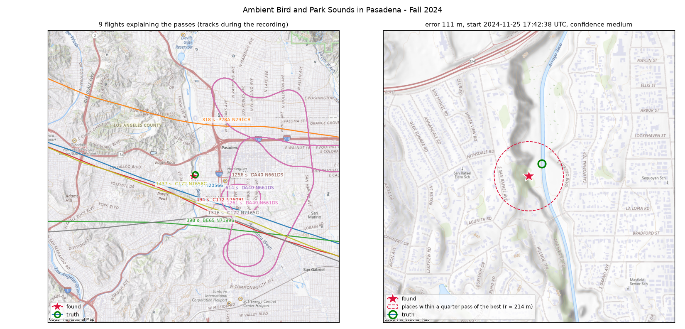
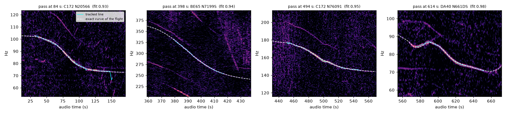
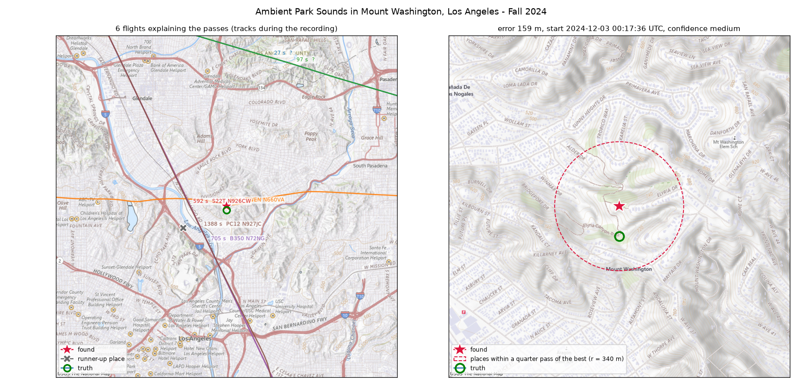
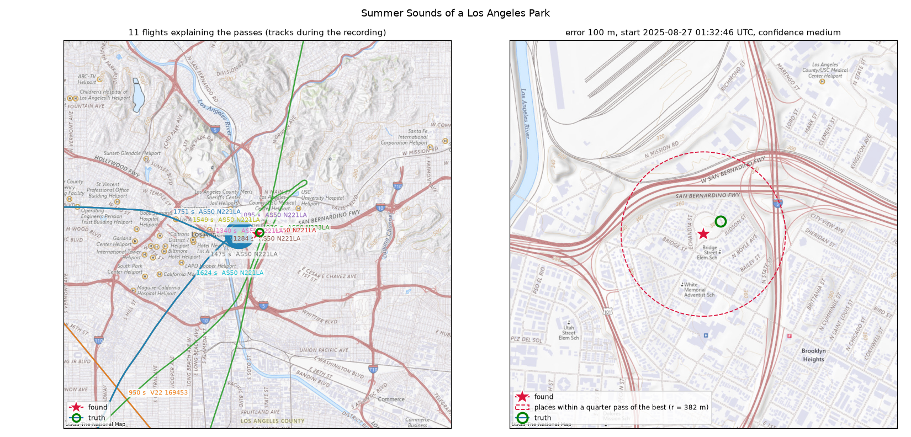

# doppler-geo

[English](README.md) | 中文

从录音里飞机经过的声音,推算这段录音是在哪里、什么时候录的。

螺旋桨飞机和直升机会发出频率稳定的嗡嗡声。飞机经过时,话筒听到的音调会慢慢往下滑,这就是多普勒效应。下滑的具体形状,取决于话筒相对航线的位置。公开的 ADS-B 历史数据记录了每架装有应答机的飞机每一秒在哪里。doppler-geo 先找出录音里的这些飞机声,再搜索在什么地点、什么开始时间,真实航班恰好会发出这样的声音。这些声音往往轻到旁边的人都不会注意,但在频谱图上很清楚。

```python
import dopgeo

result = dopgeo.locate("pasadena.webm", date="2024-11-25", tz="America/Los_Angeles",
                       center=(34.30, -117.95), radius_km=80)

print(result.lat, result.lon)        # 34.13641 -118.16873   (离真实录音地点 111 米)
print(result.recording_start)        # 2024-11-25 17:42:38+00:00   (当地时间 09:42 录的)
print(result.confidence)             # medium
```

这段录音是 YouTube 上一个 25 分钟的公园环境声视频。搜索只知道日期,以及"在洛杉矶盆地一个 160 公里见方的范围里"。它靠背景里几架小飞机的声音,算出了地点和一天中的录制时间。



左图是解释这些声音段的 9 架飞机在录音期间的航迹:几架 Cessna 172 走同一条航线,一架 Piper,一架 Beech 65,还有一架 Diamond DA40 在反复盘旋做训练。右图是近景:红色星号是找到的位置,绿色圆圈是视频描述里给出的坐标,两者相距 111 米。虚线圆圈内的地点,得分和最佳位置相差不到四分之一段声音。

这个想法来自 colsto 的视频 [*I discovered a sound that leaks your exact location*](https://www.youtube.com/watch?v=UytYrhYLOKI)。作者在一段录音上演示了这个方法,但没有公开代码。本项目是独立的开源实现,搜索方法是自己设计的,见下文。

## 目录

- [YouTube 上的真实录音](#youtube-上的真实录音)
- [原理](#原理)
- [安装](#安装)
- [使用](#使用):Python、命令行、HTTP
- [合成录音基准测试](#合成录音基准测试)
- [数据来源](#数据来源)
- [局限](#局限)
- [使用守则](#使用守则)

## YouTube 上的真实录音

[The Ambient Archive](https://www.youtube.com/@TheAmbientArchive) 这个频道发布洛杉矶各个公园的野外录音,每个视频描述里都写明了精确坐标和当地开始时间。这些录音的内容和飞机毫无关系,是鸟叫、车流、孩子和风声,小飞机只是在背景里某处经过。

我把其中长度超过 20 分钟、而且有几段清楚飞机声的录音都按同一种方式搜索:

- **范围**:洛杉矶盆地上空一个 160 公里见方的范围,中心离真实位置约 30 公里。
- **时间**:只给当地日期,一天中的录制时间完全未知。

[`examples/youtube_cases.py`](examples/youtube_cases.py) 会下载音频,复现下表。

| 录音 | 用到的声音段 | 位置误差 | 算出的开始时间 | 可信度 | 用时 |
|---|---|---|---|---|---|
| [帕萨迪纳,2024-11-25 09:42](https://www.youtube.com/watch?v=JqRT1PCNCqg) | 12 段(解释了 9 段) | 111 米 | 17:42:38 UTC(描述写 17:42) | medium | 98 秒 |
| [华盛顿山,2024-12-02 16:17](https://www.youtube.com/watch?v=3rRfrnaruFo) | 6 段(解释了 6 段) | 159 米 | 00:17:36 UTC(描述写 00:17) | medium | 39 秒 |
| [市中心附近公园,2025-08-26 18:33](https://www.youtube.com/watch?v=5PAHqKy-vRo) | 11 段(解释了 11 段) | 100 米 | 01:32:46 UTC(描述写 01:33) | medium | 56 秒 |
| [帕萨迪纳,2024-11-25 09:05](https://www.youtube.com/watch?v=UVBbkumxkek) | 7 段(解释了 5 段) | 错(35 公里) | | low | 29 秒 |
| [Elysian 公园,2024-11-24 17:25](https://www.youtube.com/watch?v=8YW6H7uB_sg) | 11 段(解释了 7 段) | 错(26 公里) | | low | 44 秒 |

5 段里有 3 段找到了,误差约 150 米以内,算出的开始时间都落在描述所写的那一分钟里。没找到的两段都标了 `low`:

- **帕萨迪纳 09:05 那段**:清楚的声音段太少。
- **Elysian 公园那段**:每段声音单独看都能和某架飞机对得很好,但对不上同一个开始时间。被剪辑拼接过的录音就会是这个样子。



这是帕萨迪纳那段录音的匹配情况。每一格是一段声音附近的频谱:

- **青色线**:从录音里追踪出的音调。
- **白色虚线**:标题里那架飞机,按它的 ADS-B 位置,在找到的地点和时间会产生的多普勒曲线。

最右边那架 DA40 正在转弯,音调先降、再升、再降,算出的曲线也跟着起伏。

<table><tr>
<td></td>
<td></td>
</tr></table>

另外两段找到的录音,布局和第一张地图相同:左边是华盛顿山,右边是洛杉矶市中心附近的公园。

### 什么样的录音能用

这个方法需要音调稳定、频率低的飞机,也就是螺旋桨飞机和直升机。这些洛杉矶录音能成功,是因为当地 1500 米以下的小飞机很多,ADS-B 接收也很密。下面是没成功的几类录音,以及原因:

- **机场拍机直播**(JFK、LAX、SFO):大型客机只有宽频轰鸣,1000 Hz 以下没有稳定的音调;主播解说和塔台通话还盖住了整个频谱。
- **缅因州乡下的水上飞机聚会**:镜头前起降的水上飞机,飞得比当地 ADS-B 接收站能收到的最低高度还低,数据里没有它们。
- **colsto 视频里的那段录音**:修好断开的音调线后,它最主要的两次飞过都被完整追踪了。但在视频里念出的坐标上,adsb.lol 的数据里找不到能用同一个开始时间同时解释这两段的飞机,2025 年和 2026 年都找不到。可能是视频用的是另外两段声音,也可能年份或坐标不同。

所以合适的录音是:

- **没剪辑**,也**没有人说话或音乐**的环境录音。
- **录在城市里或城市附近。**
- **地点和日期已知**,便于验证。

## 原理


**1. 找出录音里的飞机声。** 录音解码成 2 kHz 采样,做成频谱图。先追踪连续的音调线,把同一条线断开的几截重新接上,再把频率在下降的部分保留下来,作为声音段。

同一架飞机的几个音调(比如发动机和螺旋桨),频率在下降过程中始终保持固定比例,所以只算一段。

对每段声音,测出音调下降最快的时刻,以及下降有多快。下降速度用对数频率每秒变化多少来表示,这样就去掉了飞机本身未知的基础频率。

**2. 算出每架飞机会是什么声音。** 听者距离一架飞机 `R`,飞机速度为 `v`、加速度为 `a` 时,音调的下降速度是

    D = [ (|v|² − ṙ²) / R + a·u ] · c / (c + ṙ)²

其中:

- `ṙ` 是距离的变化速度。
- `u` 是从听者指向飞机的方向。
- `c` 是声速。

直线匀速飞过时,下降最快的时刻就是离得最近的时刻。正在转弯、爬升或加速的飞机,加速度那一项会把这个时刻推开,有时超过一分钟。`v` 和 `a` 都取自每架飞机自己的 ADS-B 数据,所以这个公式两种情况都适用。

**3. 生成候选。** 对每架飞机、以及它航迹 15 公里内的每个 1 公里格子,算出三样东西:

- 在这个格子里听到"下降最快"的时刻。
- 当时下降有多快。
- 这两者随格子内的位置怎么变。

最后一项很关键:沿航线挪动 500 米,飞机声就会晚几秒到达,所以地点和时间是绑在一起的。记下这层关系后,只花一个格子的计算量,就能检查格子内 200 米间距的 25 个点。

这一步只依赖 ADS-B 数据。到了合并那一步才用到录音:每段声音挑出下降速度对得上的飞机,再找多数声音段对上同一个开始时间的地点和时间。

**4. 检查。** 在繁忙空域,这样的巧合会有几百万个。每个候选已经为每段声音指定了一架飞机,所以先只用这几架飞机的完整多普勒曲线做一次便宜的检查。最好的几千个,再把 12 公里内的所有飞机都和每段声音试一遍。这一步会求解声音发出的时刻,也会考虑地点的地面高度。最后把最佳位置精细到 25 米。

细节见 [docs/method.md](docs/method.md),包括合并这一步为什么不必检查每个地点和时间。

## 安装

需要 Python 3.11 或更新版本,以及 [ffmpeg](https://ffmpeg.org/)(用来读取各种音频和视频格式)。

```sh
pip install git+https://github.com/cyang2020/doppler-geo
# 可选:[plot] 地图底图,[server] HTTP 接口
pip install "doppler-geo[plot,server] @ git+https://github.com/cyang2020/doppler-geo"
```

第一次搜索某一天时,会从 adsb.lol 下载当天的 ADS-B 历史:大约 3.5 GB,解压整理后每个 UTC 日约占 1 GB,存放在 `~/.cache/dopgeo/adsb`(可用 `DOPGEO_CACHE` 改成其他目录)。按当地日期搜索需要两个 UTC 日的数据。可以用 `dopgeo fetch 2024-11-25` 提前下载。

## 使用

### Python

```python
import dopgeo
from dopgeo.plot import plot_result

# 录音里有哪些飞机声
for p in dopgeo.detect_passes("recording.wav"):
    print(p.time_s, p.rest_frequency_hz, p.clear, p.fastest_fall_s)

# 在哪里、什么时候
result = dopgeo.locate(
    "recording.wav",
    date="2024-11-25", tz="America/Los_Angeles",  # 或 start="2024-11-25T17:40Z", start_tolerance_s=1800
    center=(34.1, -118.2), radius_km=80,          # 或 area=dopgeo.Area(lat_min, lat_max, lon_min, lon_max)
    exclude_jets=False,                           # True 表示忽略已知的喷气机型
    output_dir="out",                             # 可选:输出 result.json、map.html、curves.png
)
for m in result.matches:                           # 每段声音由哪架飞机解释
    print(m.audio_time_s, m.aircraft_type, m.registration, m.fit)
plot_result(result, "result.png")
print(result.to_json())
```

`locate` 返回一个 `Result`,包含以下内容:

- 地点。
- UTC 开始时间。
- 可信度标签。
- 每段声音对应的飞机。
- 2 公里以外的第二名地点。
- 各步骤的用时。

`dopgeo.synthesize` 可以用真实航迹生成测试用的合成录音。

### 命令行

```sh
dopgeo passes recording.wav                       # 列出声音段
dopgeo locate recording.wav --date 2024-11-25 --tz America/Los_Angeles \
       --center 34.1 -118.2 --radius-km 80 --out out/
dopgeo synth --lat 34.137 --lon -118.168 --start 2024-11-25T17:42:00 \
       --duration 1500 --out test.wav            # 用真实航迹生成合成录音
```

### HTTP

```sh
pip install "doppler-geo[server] @ git+https://github.com/cyang2020/doppler-geo"
dopgeo serve --port 8000
curl -X POST http://127.0.0.1:8000/locate -F file=@recording.wav \
     -F date=2024-11-25 -F tz=America/Los_Angeles -F center_lat=34.1 -F center_lon=-118.2 -F radius_km=80
```

几个接口:

- `POST /locate`:返回的字段和 `Result.to_dict()` 相同。
- `POST /passes`:列出声音段。
- 交互式文档:在 `http://127.0.0.1:8000/docs`。

一次搜索在整个运行期间都会占住请求,所以这个服务适合本机或内部使用。

### 可信度

- `high`:至少解释了 4 段声音,比 2 公里以外的最佳地点领先至少 1.5 段,总分至少是声音段数的 60%。
- `medium`:至少解释 3 段,领先 0.75 段,总分 40%。
- `low`:其余情况。

在这里的所有测试中,标 `high` 的答案没有错过;标 `low` 的有时对、有时错,意思是这段录音不足以排除其他地点。

## 合成录音基准测试

[`benchmarks/`](benchmarks/) 里有 20 段合成录音。每段都取自某个真实地点、真实时间附近 6 公里内经过的真实航班:每架飞机变成一个带多普勒频移的音调,基础频率和谐波随机,再加上噪声。搜索方式和上面的 YouTube 录音相同:160 公里见方的范围,中心离真实位置 25 到 45 公里,只给当地日期。运行 `python benchmarks/run.py` 可以重新生成并重跑。

至少有两段声音的 19 段录音全部找到,误差 6 到 213 米(中位数 31 米),开始时间误差都在 2.1 秒以内;只有一段声音的那段被拒绝。用时是在一台同时跑着别的程序的 8 核笔记本上测的(平均负载 13 到 20),中位数 37 秒。

这些录音比真实录音容易:里面每架飞机,包括大型客机,都会发出干净的音调,而且没有其他声音。

| 案例 | 录音里的飞机 | 误差 | 开始时间误差 | 可信度 | 用到 / 解释的声音段 | 用时 |
|---|---|---|---|---|---|---|
| long-island | 10 | 28 米 | +0.1 秒 | high | 12 / 11 | 144 秒 |
| sf-bay | 16 | 31 米 | +0.2 秒 | high | 12 / 10 | 39 秒 |
| denver | 18 | 159 米 | +0.1 秒 | high | 12 / 11 | 36 秒 |
| irvine-a | 2 | 9 米 | +0.2 秒 | medium | 5 / 3 | 46 秒 |
| orlando-a | 24 | 6 米 | +0.1 秒 | high | 12 / 12 | 24 秒 |
| seattle-a | 18 | 59 米 | -0.2 秒 | high | 12 / 10 | 18 秒 |
| chicago-a | 12 | 35 米 | -0.2 秒 | high | 12 / 12 | 37 秒 |
| dallas-a | 17 | 36 米 | +0.0 秒 | high | 12 / 11 | 59 秒 |
| boston-a | 3 | 59 米 | +0.3 秒 | medium | 4 / 4 | 12 秒 |
| austin-a | 27 | 11 米 | +0.3 秒 | high | 12 / 12 | 11 秒 |
| portland-a | 4 | 24 米 | +0.0 秒 | high | 6 / 5 | 11 秒 |
| irvine-b | 15 | 8 米 | -0.1 秒 | high | 12 / 6 | 102 秒 |
| orlando-b | 14 | 25 米 | +0.4 秒 | high | 9 / 6 | 45 秒 |
| seattle-b | 44 | 201 米 | -2.1 秒 | medium | 12 / 8 | 31 秒 |
| chicago-b | 6 | 28 米 | +0.1 秒 | high | 6 / 6 | 27 秒 |
| dallas-b | 64 | 213 米 | +1.3 秒 | high | 12 / 10 | 45 秒 |
| boston-b | 10 | 38 米 | -0.4 秒 | high | 12 / 10 | 64 秒 |
| austin-b | 8 | 16 米 | +0.2 秒 | high | 10 / 9 | 15 秒 |
| portland-b | 1 | 拒绝(只有一段) | | | | 1 秒 |
| oyster-bay | 12 | 149 米 | +0.6 秒 | high | 11 / 6 | 68 秒 |

## 数据来源

| 数据 | 来源 | 许可 | 用途 |
|---|---|---|---|
| ADS-B 历史 | [adsb.lol globe_history](https://github.com/adsblol) 每日发布 | ODbL 1.0 | 每架飞机在哪里 |
| 地形高度 | [AWS 上的 Terrain Tiles](https://registry.opendata.aws/terrain-tiles/) | 见数据集说明 | 听者的高度 |
| 机型 | [tar1090-db](https://github.com/wiedehopf/tar1090-db) | 见该项目 | 区分喷气机和其他飞机 |
| 大地水准面(EGM96) | PROJ 数据 | | 换算 ADS-B 高度 |
| 地图底图 | [USGS The National Map](https://www.usgs.gov/programs/national-geospatial-program/national-map) | 公有领域 | 示意图 |

这些数据都不随项目分发,首次使用时下载。YouTube 上的录音也不分发,由示例脚本自行下载。

## 局限

- 只有广播 ADS-B、并被 adsb.lol 网络接收到的飞机,才能用来解释声音段。远离城市、飞得很低的小飞机经常收不到。
- 大型客机很少有可用的音调,声音段主要来自螺旋桨飞机和直升机。
- 清楚的声音段只有两三段时,往往有好几个地点同样吻合,结果会标 `low`。
- 搜索时间随区域内的航班量增长。在一台 8 核笔记本上(同时还在跑别的程序),洛杉矶上空 160 公里见方的范围用了 30 秒到 2 分钟;50 公里见方的范围远低于一分钟。整个美国本土要几个小时。
- 人声、音乐,以及剪掉中间部分的剪辑,都会让方法失效。它假设录音是在固定位置连续录下来的。
- adsb.lol 的 ADS-B 历史从 2023 年开始。

## 使用守则

这个技术可以从一个人没想到会泄露位置的录音里,推算出他当时在哪里,哪怕录音里根本听不到飞机。公开它,是为了让大家了解并检验这种风险,比如在分享自己的录音之前,先看看它会透露什么。请不要在未经同意的情况下用它定位他人。

## 许可

MIT,见 [LICENSE](LICENSE)。
